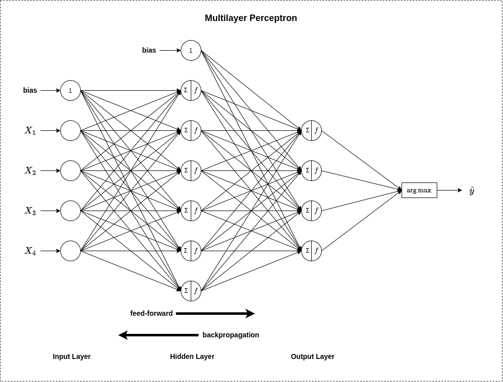

  <b>Language:</b> 
  <b>🇺🇸 English</b> |
  <a href="./README.pt-br.md">🇧🇷 Portuguese</a>

  <h2>Artificial Neural Network from Scratch</h2>

<h3>Implementation of a Multilayer Perceptron (MLP) built without PyTorch or TensorFlow libraries.</h3>

This project demonstrates how an Artificial Neural Network works under the hood by building every
mathematical component from scratch using only Python and NumPy. 

<h3>Technologies and Technical Details</h3>

- **Programming Language**: Python
- **Environment**: Jupyter Notebook
- **Machine Learning Model**: Multilayer Perceptron (MLP)
- **Libraries**: pandas, numpy, matplotlib and sklearn.datasets

<h3>Artificial Neural Network Screenshot:</h3>

    

