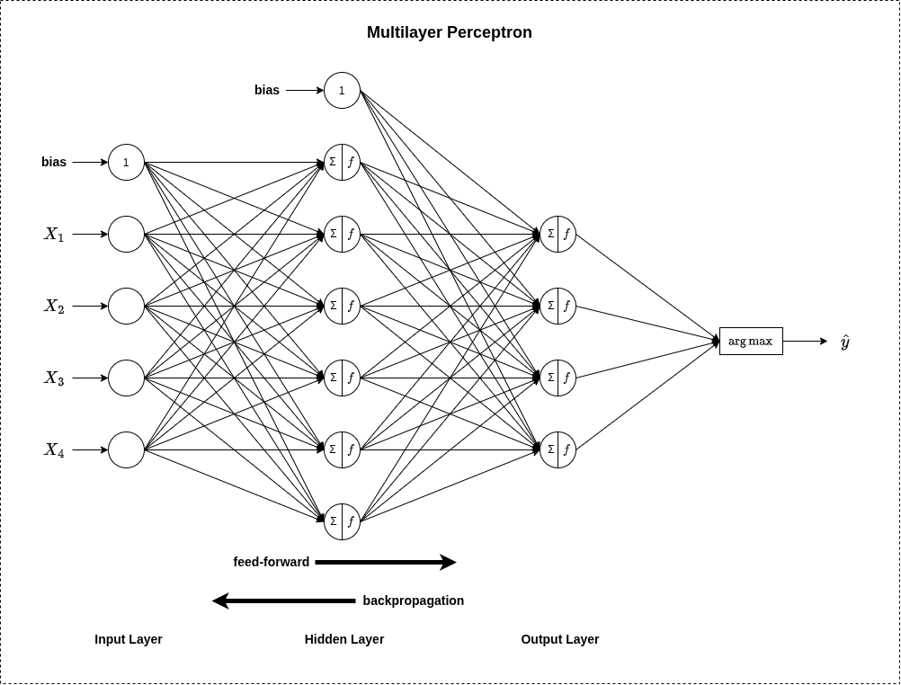

  <b>Idioma:</b> 
  <a href="./README.md">🇺🇸 Inglês</a> |
  <b>🇧🇷 Português</b>

  <h2>Rede Neural Artificial do Zero</h2>

<h3>Implementação de um Perceptron Multicamadas (MLP) construído sem as bibliotecas PyTorch ou TensorFlow. Este projeto demonstra
como uma Rede Neural Artificial funciona "dentro da caixa preta", construindo cada componente matemático do zero usando
apenas Python e NumPy</h3>

<h3>Tecnologias e Detalhes Técnicos</h3>

- **Linguagem de Programação**: Python
- **Ambiente**: Jupyter Notebook
- **Modelo de Machine Learning**: Perceptron Multicamadas (MLP)
- **Bibliotecas**: pandas, numpy, matplotlib e sklearn.datasets

<h3>Captura de Tela da Rede Neural Artificial:</h3>

    

